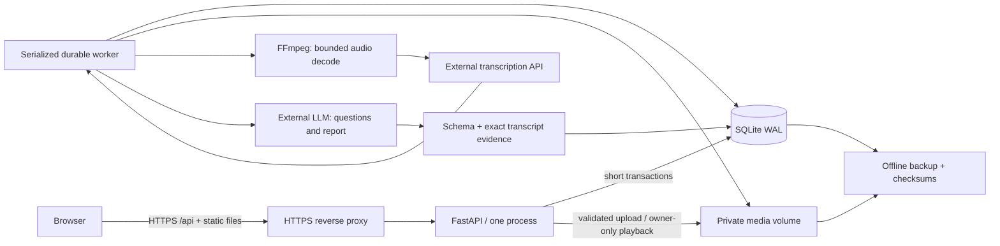

# Pilot architecture

The browser and REST API share one origin. `public/` is native JavaScript/CSS, served by FastAPI. The application is one process on one host, with SQLite WAL and private files on a persistent volume. A serialized asynchronous worker polls a database-backed job queue. A reverse proxy must terminate HTTPS in production.

## Account and data boundaries

Passwords are Argon2 hashes. The cookie contains an opaque session secret; only its hash is persisted. Cookies are HttpOnly/SameSite Strict and Secure in production. Authenticated mutations need a CSRF token from `/api/auth/me`, plus allowed origin. Registration requires consent; production requires an expiring, limited-use invitation. Password recovery is an operator-issued expiring one-use code after an external identity check. Reset invalidates existing sessions.

Practice configuration, segments, transcripts, reports and jobs belong to a user. Ownership is checked on every direct endpoint including media and jobs. Uploaded filenames are generated by the server; files are never in the static directory. No credentials or recordings enter localStorage for authenticated operation.

## Processing and recovery

1. Create a private practice and its settings.
2. Upload the speech segment; validate and persist bytes before success.
3. Queue questions or analysis. A duplicate active request returns the existing job.
4. Decode bounded audio, transcribe, and commit each completed transcript and usage record.
5. Optionally generate questions and upload answers as separate segments; provider wait time is excluded from recording duration.
6. Generate a structured report, check the schema and exact quotations, derive word counts and average recording rate locally, then persist the report and job completion together.
7. The browser polls job status and can resume after reload. Startup recovers interrupted running jobs; completed transcripts are reused.

Recovery is at-least-once. If the process crashes after the provider accepted a request but before the database saved the result, the provider call can be repeated and charged again. This pilot does not claim exactly-once remote billing.

The worker never holds a SQLite transaction while awaiting a remote call. One worker bounds provider concurrency; per-user upload/practice/job quotas bound use. SQLite and local files deliberately limit this release to one host. Multiple replicas require a different coordination/storage design.

## Observable limits

The report assesses transcript content. It does not measure intonation, pauses, gestures, anxiety or psychological confidence. Average words per minute uses recognized words divided by actual segment duration including silence. Transcription and AI findings can be inaccurate; quotation checks establish provenance, not objective correctness of every recommendation.

Health checks show process/storage/configuration readiness; provider configuration is not a provider health guarantee. Logs and metrics are stored separately from speech content. Offline backups include private content and must be protected like production data.
