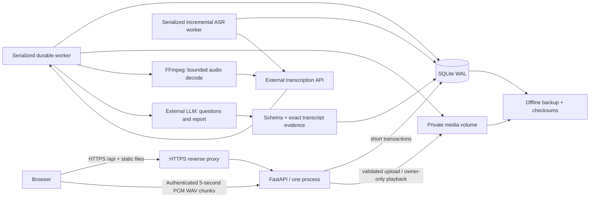

# Pilot architecture

The browser and REST API share one origin. `public/` is native JavaScript/CSS, served by FastAPI. The application is one process on one host, with SQLite WAL and private files on a persistent volume. Two serialized asynchronous workers poll database-backed queues: one for incremental speech transcription and one for final questions/reports. A reverse proxy must terminate HTTPS in production.

## Account and data boundaries

Passwords are Argon2 hashes. The cookie contains an opaque session secret; only its hash is persisted. Cookies are HttpOnly/SameSite Strict and Secure in production. Authenticated mutations need a CSRF token from the auth response, plus allowed origin. Registration has no consent step: new accounts store the legacy flag as false, and uploads do not gate on it. Registration is open without invitation codes in every environment. Password recovery is an operator-issued expiring one-use code after an external identity check. Reset invalidates existing sessions.

Practice configuration, segments, transcripts, reports and jobs belong to a user. Ownership is checked on every direct endpoint including media and jobs. Uploaded filenames are generated by the server; files are never in the static directory. No credentials or recordings enter localStorage for authenticated operation.

## Processing and recovery

1. Create a private practice and its settings.
2. Upload the speech segment; validate and persist bytes before success.
3. Queue questions or analysis. A duplicate active request returns the existing job.
4. Decode bounded audio, transcribe, and commit each completed transcript and usage record.
5. Optionally generate questions and upload answers as separate segments; provider wait time is excluded from recording duration.
6. Generate a structured report, check the schema and exact quotations, derive word counts and average recording rate locally, then persist the report and job completion together.
7. The browser polls job status and can resume after reload. Startup recovers interrupted running jobs; completed transcripts are reused.

Recovery is at-least-once. If the process crashes after the provider accepted a request but before the database saved the result, the provider call can be repeated and charged again. This pilot does not claim exactly-once remote billing.

Workers never hold a SQLite transaction while awaiting a remote call. Each queue runs one provider operation at a time, with at most two concurrent operations across the two queues. Per-user upload/practice/job/chunk quotas bound use. SQLite and local files deliberately limit this release to one host. Multiple replicas require a different coordination/storage design.

Authenticated speech capture keeps the full MediaRecorder recording and runs a parallel AudioWorklet for independent mono 16 kHz PCM WAV chunks. The worklet is armed only when recording starts, so the microphone check is never transcribed. MediaRecorder timeslice blobs are not used as independent files: they may lack container headers. See [MDN recording API](https://developer.mozilla.org/en-US/docs/Web/API/MediaStream_Recording_API) and [AudioWorklet](https://developer.mozilla.org/en-US/docs/Web/API/Web_Audio_API/Using_AudioWorklet).

Each private chunk belongs to a practice and capture session; ordered indices, offsets and content hashes protect retries. Successful transcripts and provider usage survive restart. The final speech upload binds the capture session to its authoritative saved recording. Questions/reports reuse a complete, contiguous, duration-matched transcript only; missing or failed chunks trigger full-recording transcription. Browser capability, upload and polling failures never discard the complete recording. Guests retain the existing local draft and authenticate before any provider call. Questions appear only after the speech ends; incremental transcription does not change the meeting or answer flow.

## Observable limits

The report assesses transcript content. It does not measure intonation, pauses, gestures, anxiety or psychological confidence. Average words per minute uses recognized words divided by actual segment duration including silence. Transcription and AI findings can be inaccurate; quotation checks establish provenance, not objective correctness of every recommendation.

Health checks show process/storage/configuration readiness; provider configuration is not a provider health guarantee. Logs and metrics are stored separately from speech content. Offline backups include private content and must be protected like production data.

## Production coordination

The application instance lease prevents two workers sets from sharing one database. A shared runtime data lease excludes offline backups; invitation/reset CLI access uses the same shared lease. The Linux release controller adds a separate deployment-root lease, blocks business traffic and new provider claims during candidate validation, and promotes an immutable image/configuration only after readiness and a verified restore rehearsal. Pre-activation failures can restore the previous snapshot; activated/manual code rollback preserves current user writes.

Durable `ai_attempts` reservations cover both workers, every HTTP retry, rolling global/account/request-rate budgets and conservative audio/character/output ceilings. Reservations remain independent of deletable practice/usage rows. A persistent AI switch prevents new claims/calls. The supervisor writes bounded worker heartbeats and prunes telemetry without removing recordings. Private status and local/external alert probes combine worker liveness, queue age, errors, storage and backup freshness. Encrypted snapshots and their exact restores are verified before retention is applied.
