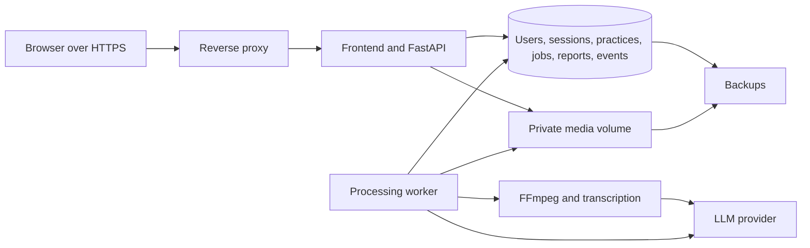

# First-user production pilot: execution plan

Created: 2026-10-11. Target: one working day, implemented by Codex across successive passes. This plan supersedes the earlier multiweek estimate for the first-user pilot. It is a work plan, not evidence of completed implementation.

## Finish condition

An invited user opens an HTTPS URL, creates an account, completes a guided first practice, receives an analysis of their own speech, reopens the recording and report after signing in again, and completes another attempt using a recommendation. Two independent users cannot access each other's data. The operator can see failures, usage and processing costs, and restore a backup.

## Verified baseline

- `public/` is a vanilla JavaScript frontend with scenario selection, settings, device checks, MediaRecorder, playback, questions, report and history screens.
- Registration throws `AUTH_NOT_CONFIGURED`; there is no authentication backend.
- Questions are static. Analysis returns `demoResult` rather than analyzing the recording.
- Recording blobs live in the tab; history metadata lives in localStorage. There is no account-level storage.
- The folder is a ZIP import without a Git repository. No production deployment has been established in this workspace.
- Copywriting research is in `outputs/copywriting-research.md`; it supplies editorial guidance, not completed UI changes.

## Delivery shape

Use the existing frontend, one FastAPI application, SQLite on a persistent local volume, private media files, FFmpeg and the supplied OpenAI-compatible provider. Use a database-backed job queue with a worker, bounded concurrency, recovery after restart and no database transaction held during provider calls. Serve frontend and API from one origin. This is a single-host pilot deployment; horizontal replicas require a later storage/database decision.

## Implementation order

| Pass | Work | Checkpoint before advancing |
|---|---|---|
| 1. Accounts and persistence | Database migrations; invitation registration; email/password login; logout; session expiry; password hashing; HttpOnly/Secure cookies; CSRF protection; login limits; current-user endpoint; operator-assisted one-use recovery for the invited pilot; practice ownership and private file access. | Two users sign in independently. Reload preserves login. A user cannot read, modify or delete another user's practice or media, including by direct URL. Logout invalidates the session. |
| 2. Recording and analysis | Create a practice; save configuration; upload speech and answer segments; validate size and actual media; persist records before confirming success; convert audio; transcribe; generate content-based questions and a structured report; persist provider usage, prompt/model version and job status. | A real Russian recording produces its own transcript and report. Refresh and worker restart preserve the practice. A failed analysis can be retried from the saved recording. |
| 3. Complete the product flow | Replace demo API adapter; distinct landing and workspace; login return path; practical first exercise; scenario settings; audio-only fallback; recording indicators; upload/processing progress; report with evidence and one priority; playback/download; history; repeat practice; deletion; inline errors and feedback. | A new user completes the whole flow without developer assistance. Returning users resume relevant work. Demo results are separate from actual analysis. |
| 4. Production and acceptance | Container configuration; HTTPS deployment; persistent volumes; secrets configuration; process restart; health/readiness; backups and restoration; smoke and security checks; bounded load tests; README, architecture, usage/cost and load reports. | The final release passes the finish-condition checklist at its external URL. Operator feedback/support and rollback procedures are usable. |

## Specific product decisions for the pilot

- Start with invited users. Invitation registration avoids introducing a mail service as a dependency for the first pilot. Provide an operator-assisted recovery procedure with identity checking and expiring one-use tokens; never send or disclose an existing password. Automated email verification and recovery must be added before opening unrestricted registration.
- Keep the public report example and existing anonymous local practice explicitly marked as demonstration/local behavior. Account-based practice is the path for persistent records and real analysis.
- Preserve all three existing scenarios. A first guided exercise takes 60–90 seconds; ordinary practice defaults to five minutes, with an initial ten-minute limit. Server-side byte limits and a per-user generation quota bound pilot usage; final values must fit measured encoding size and provider limits.
- Stop and save the speech segment before generating audience questions. Record answers separately so provider waiting time is not treated as speech. Transcribe and preserve segment identity when composing the final report.
- Validate the report schema. Each finding needs transcript evidence; timestamps are shown only when the transcription pipeline actually provides them. Report measurable quantities with units and a method. Do not infer gestures, emotions or psychological confidence from a text-only pipeline.
- Render provider output as untrusted text. User speech and criteria are data for analysis, not instructions that can override the report contract.
- Retry transient provider errors with bounds. Invalid output or exhausted retries yields an actionable failed status, never a fake successful report. Prevent duplicate active jobs and duplicate uploads from repeated clicks.
- State what is recorded, that content is processed by an external AI service, how long it is retained and how to delete it. The owner/contact and applicable user-consent wording must be supplied before publication. Participant eligibility and consent need an explicit decision if the first cohort includes minors.
- Redesign the landing with clear Russian copy and a visible report demonstration. Apply the supplied visual references through typography, product visuals and modest motion. Keep onboarding inside the actual exercise/report flow. Respect reduced-motion preferences.

## Observability and competition deliverables

- Store events for login, practice start, recording saved, report ready, repeat attempt, feedback and service failure. For the pilot, define DAU as distinct authenticated users who start a practice or open their own report during a Moscow calendar day. Keep the event definition and timezone in the metrics documentation.
- Record request/job IDs, status, elapsed time, provider/model, token usage and audio duration. Keep passwords, credentials and raw user recordings/transcripts out of general application logs. Provide operator-only metrics and CSV/JSON export.
- Measure API load at 1, 5 and 10 RPS, then run a bounded stress ramp. Report endpoint mix, duration, concurrency, p50/p95/p99 latency, errors, resource usage and the observed failure point. Test account isolation and storage behavior under concurrent work.
- Run ordinary API and queue load separately from a small measured sample of real AI jobs. Clearly label provider stubs and real calls; 10 RPS on API endpoints does not establish 10 RPS capacity for full AI processing. Measure actual tokens/minute (TPM), tokens/second (TPS), audio throughput and queue delay for real calls.
- Calculate `cost/DAU = practices per active user × (transcription cost + question-generation cost + report cost)`. Use measured token/audio usage and actual provider tariffs. Show scenarios with one, two and five practices per day; distinguish assumptions from measured results and failed/retried-call costs. Tariffs are currently missing, so a currency estimate is not yet verified.
- Update the Russian README with setup, environment-variable names, run/deploy instructions, product limitations, recovery/support and validation results. Add one architecture diagram and short English operational documentation.

## Release checks

1. External HTTPS link works on desktop and mobile; microphone recording works in a supported browser.
2. Registration, login, logout, expiry and the documented recovery path work.
3. The full speech → optional questions/answers → report → repeat cycle works.
4. Recordings, configurations and reports survive reload, re-login and application restart.
5. Two users cannot access each other's data; media files are not served from a public directory.
6. Microphone denial, silence, upload interruption, unsupported media, provider timeout and invalid output have useful recovery paths.
7. Ownership-protected deletion, quotas, metrics export and user feedback work.
8. Backup restoration has been exercised. Health checks, automatic restart and rollback instructions are present.
9. Load report, architecture, README and usage/cost assumptions are available; missing provider pricing is clearly marked rather than invented.

## External dependencies and scope boundary

Required before external launch: deployment access, a hostname or supported platform HTTPS URL, server-side provider credentials, provider quotas/tariffs, and the service owner's contact/retention/participant decisions. Preparing and checking the application can proceed while these are resolved; external readiness depends on them.

The first-day scope excludes payments, social login, advanced video/body-language analysis, complex gamification, a large admin application and expensive generated cinematic assets. First-user usability, private durable data, real analysis and operational recovery remain required.

Maintain relevant root agent instructions when implementation begins, capture a Git baseline for the ZIP import, and commit meaningful verified changes without secrets. Do not infer permission to overwrite remote `main`; the existing project instruction names `frentend` for remote frontend work. Push/deploy status must be reported from actual tool results.

## Technical references checked

- [FastAPI background processing](https://fastapi.tiangolo.com/tutorial/background-tasks/): asynchronous job handling must be designed separately from the browser request lifecycle; the durable queue is our implementation decision.
- [SQLite WAL](https://www.sqlite.org/wal.html): supports the proposed local single-host storage choice; write concurrency and backup behavior require practical verification.
- [OWASP authentication guidance](https://cheatsheetseries.owasp.org/cheatsheets/Authentication_Cheat_Sheet.html) and [session guidance](https://cheatsheetseries.owasp.org/cheatsheets/Session_Management_Cheat_Sheet.html): baseline for account, cookie, recovery and session checks.
